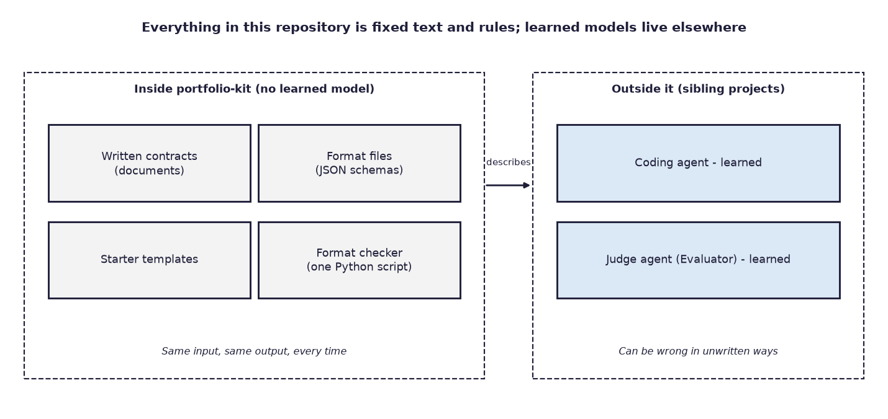
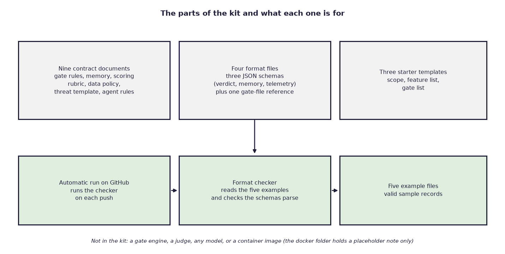
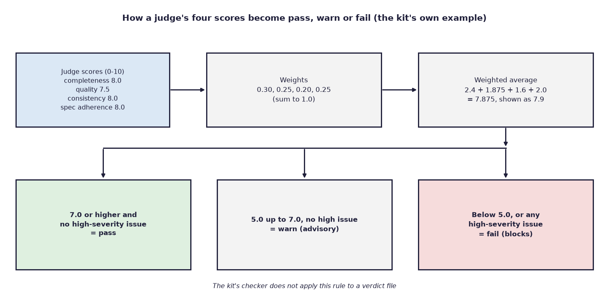
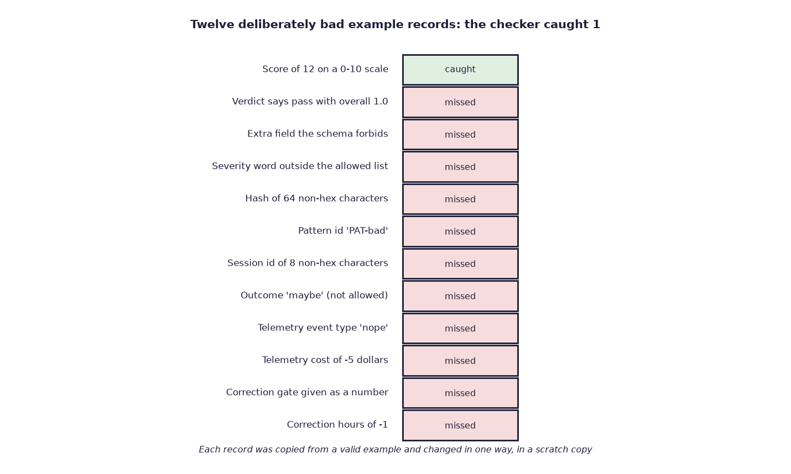

# portfolio-kit

*A small shared folder of written rules, file formats and starter files that my AI (artificial intelligence) engineering projects copy from, so that each one does not invent its own way of saying "this work passed its check". It contains no AI model, only fixed text and one small checking script.*

Status: an early, small foundation, written between 19 August and 4 September 2026 and labelled version 0.1.0 in its documents. Code: https://github.com/PCSchmidt/portfolio-kit (public, MIT (Massachusetts Institute of Technology) licence, a permissive open-source licence). It has no releases, no stars and no copies, and nothing shows that anyone but me has used it.

There is no AI here. Everything in the kit is fixed rules, so it behaves the same way every time. Think of a calculator, which always gives the same answer to the same sum, against a weather forecast, which is a best guess that can be wrong. This kit is the calculator. The forecast-like parts, the AI agents that the rules are meant to keep in check, live in other projects of mine. Here is the problem the rules address. An AI coding agent says "done", and the work is not done. A *gate* (a checkpoint that work must pass before it moves on) refuses to move until a separate check passes. I call this the running example: the agent says "done", the gate says "not yet".

I run several projects that apply this idea to different jobs. They all descend from Meridian, an earlier project of mine: scripts and rules that sit around an AI coding agent and block it from declaring work finished until a check passes. Meridian also uses a *judge*, a second AI agent that scores the work without having written it. The *sibling projects* are the others that follow Meridian's pattern: a plugin that enforces honesty, a comparison of agent-building libraries, a documentation agent, a retrieval system that answers questions from documents, and a variant of Meridian built around interpretable memory. If each invented its own format for "gate passed" and "the judge's score", I could not compare them or reuse anything. portfolio-kit is where the shared version is written down once. It holds nine short documents, four format files, three starter templates, five sample records and a script that checks the samples.

A *contract* here is a written agreement about what a record must contain and what a word like "pass" means. A *schema* is the machine-readable version: a file listing which fields a record must have and what values they may hold. The contracts come from Meridian, and the kit keeps them in one versioned place.

Here is the plain conclusion. The kit is useful mainly as a map of how my project family fits together, and it is thin as software. Its one checking script looks at five sample files and tests only part of what the schemas say. In a trial the script caught one of twelve deliberately broken records, so "validated" overstates what it does. The kit has no tests of its own, nothing in it has been measured, and I do not know how closely the sibling projects follow it.



The documents describe how an AI agent's own claim of success must not count as a pass, and what record a judge must produce. The kit does not enforce either. AI coding agents wrote almost all of the text and the script, and I directed the scope, plan, architecture and preferences. If you have ten minutes, read the chapter on the rules and numbers, the one on trying to break the checker, and the one on real use.

In short, this is a quiet foundation folder whose value depends on the projects that adopt it.

## What problem this solves

AI coding agents tend to announce that work is done when it is not. Meridian was my answer: block the agent until a check passes, and have a judge score the work. Once several projects applied the same pattern, they needed to agree on four things. What counts as a pass? What does a judge's score look like? How are notes between work sessions stored? How are results scored and reported? Without agreement each project drifts.

The people with this problem are anyone running a family of similar AI projects, which in practice means me. The README (the project's front-page document) calls Meridian the "reliability spine" and says the kit versions its contracts so the siblings can use them without making a second, competing gate format. Success would mean that every sibling reads the same contract. Today the only measure is that the sample records pass the checking script. Whether the siblings really match the kit is not measured here.

The kit deliberately does not build gates, judges or memory stores, which live in Meridian and the siblings. It does not accept employer, program or classified data; its data policy limits examples to public, unclassified material. It has no container image, and the folder reserved for one holds only a placeholder note. Its own document lists later phases that do not exist.

Similar ideas exist elsewhere. JSON Schema, a widely used format for describing what a data file must contain, already covers the format side, and no survey of alternatives is recorded. A skeptic would ask why a few documents need a repository at all. The fair answer is that one place with a version number lets several repositories point at one definition. The weaker half is that nothing here forces a sibling to stay in step.

## What a user gets

The user is a developer starting or adapting one of my projects. Think of a franchise handbook: a new branch does not invent its own safety rules and receipt format, it gets head office's binder of blank and sample forms. The kit is that binder, with one difference. A binder's rules are enforced by inspectors, and here the inspector is mostly absent.

A developer begins a new sibling project and copies the three starter templates: one states the scope, one lists features and how to tell each is done, and one lists the gates. A typical gate list says to confirm the scope with a typed human approval, then pass the tests, then pass the judge. In the running example, the agent says "done", and the gate list says nothing moves until each of those checks has passed. The developer keeps records in the schema formats and publishes results with the shared scoring list. A coding agent in that project is told, by an instructions document, to read the data policy and the gate contract first.

The kit's own sample shows what a judge's record looks like. A judge looked at two project documents for a gate called "confirmed". It scored completeness 8.0, quality 7.5, consistency 8.0 and fit to the written specification 8.0, each out of 10, found no issues and returned "pass".

Copying a starting gate list works today. Running the script to check a judge's record works only in part. Pinning a project to a published release is not possible yet, because there are no tags. Nothing in the chain is automatic except the one script. The contract says a human must approve a scope gate by typing an approval word that a model cannot infer, but the kit contains no program that enforces this. Using it in a government or regulated setting would first need approved data sources, access control and review, none of which belong in a folder of templates.

## The parts and how they fit

The kit is a folder of small files, and it helps to meet them by job.

The *contract documents* say in words what each shared idea means: how the family is arranged, what it takes to pass a gate, memory, scoring, the data policy, a blank threat-model form, how to reproduce a run, a map of local folders against GitHub addresses, and instructions for coding agents. A tenth document, the status file, is a hand-off note recording what each sibling had shipped on 4 September 2026.

The *format files* are three schemas written in JSON (JavaScript Object Notation, a plain-text format for structured data), covering a judge's verdict, the three kinds of memory and the event log (called telemetry, meaning a record of what a program did and when). A fourth reference describes the gate list in YAML (YAML Ain't Markup Language), another plain-text format that people find easier to read. It says plainly that it is documentation, not a schema a program can check against.

The *three templates* start a scope statement, a feature list and a gate list. The *five sample records* are valid examples: one judge verdict, one memory file, and short examples of session events, corrections and telemetry. The *checking script* is one Python file that loads the schemas, reads the samples and tests them. An automatic run on GitHub (the code-hosting website) executes it on each push. All 19 runs succeeded, though the script checks little, as the testing chapter shows.



Two rules matter most, and they are written down, not enforced. First, an agent scoring its own work is never a pass. Second, an invalid memory write must stop the work, not be ignored. The documents call this "fail closed": when something is wrong, refuse instead of letting it through. Both are conditions on the siblings, and nothing here would notice if a sibling broke them. If the shared schemas change, projects that copied them need updating by hand, because nothing links them.

In short, the kit is documents, formats and samples, with one small script as its only moving part.

## The rules and numbers inside the contracts

The kit contains little mathematics. Two sets of rules matter.

A gate passes only when five things hold. The gates it depends on have passed. Required files exist and are not empty. Any automatic check that must run first ends with the code meaning success, where 0 means success and 2 means "block"; the point is that a model cannot argue with a number. A judge, if the gate needs one, returns a pass. And a human approval, if required, is an explicit word a person typed. In the running example, a gate refuses the agent's "done" until all five hold.

The judge scores completeness, quality, consistency and fit to the specification, each from 0 to 10, and the contract weights them 0.30, 0.25, 0.20 and 0.25, which add up to 1. The overall score is the weighted average. Using the kit's own sample: 8.0 × 0.30 = 2.4, 7.5 × 0.25 = 1.875, 8.0 × 0.20 = 1.6 and 8.0 × 0.25 = 2.0. The total is 7.875, which the sample rounds to 7.9. A score of 7.0 or more with no high-severity issue is a pass. From 5.0 up to 7.0 is a warning, advisory unless a project promotes it. Below 5.0, or any high-severity issue, is a fail. Four scores of 6 give 6.0, a warning, and a single high-severity issue would turn any average into a fail. The weights and the 7.0 pass mark are Meridian's defaults, a choice and not a derived result, and nothing shows how they were picked. Nothing in the repository checks that a record's overall score equals this sum or that its verdict word agrees with the thresholds.



To show why a separate judge matters, the contract quotes one measurement from Meridian: an agent grading its own deliberately bad code gave it 5.5, and a fresh agent that had not written it gave 2.5, a difference of 3.0. This is a single example from another project, and the kit does not run the test.

Memory comes in three kinds of file. *Semantic memory* holds patterns that held across projects, each with a confidence label. *Episodic memory* is an append-only log of session events. *Corrections* record a prediction against what happened: 4 hours predicted and 3 actual gives a ratio of 0.75 and a variance of minus 25 percent, which matches the sample. Semantic entries are de-duplicated with a *hash*, a short fingerprint of some text, so two entries with the same text are recognised as repeats.

The shared scoring template defines nine measures for any public results table, among them grounded citations, how many known-bad outputs a gate blocks, a rate of made-up content, speed and cost. It also demands that every published rate state its sample size.

## Why there is no model chapter

The kit runs no AI model, calls no service and needs no key. The contracts describe a judge, but it lives in other repositories, and the kit names no model for the job. The kit limits the models around it only through the contract: a self-score is not a pass, a judge works in a fresh context and returns a fixed record, and a person types an approval for certain gates.

## Testing and trying to break it

The repository has no test suite of its own. Its only automatic check is the format checker. In a scratch copy it passes and prints "OK". It confirms that the three schemas are readable JSON, that the five samples exist and parse, and that each has the required fields and a few simple limits. It does not read the YAML files, and it does not use the schemas at all; its rules are written out by hand as a loose copy of them.

To see how loose, a test in a scratch copy spoiled each valid sample in one way, one at a time, and ran the checker. Of twelve spoilings, it caught one, a score of 12 on a scale that stops at 10. It passed the other eleven. Among them were a verdict that says "pass" with an overall score of 1.0, an extra field the schema forbids, an outcome word of "maybe", a negative cost, and a hash made of letters that are not hexadecimal digits (0 to 9 and a to f).



This is a fair test but a limited one: the breakages were chosen by hand, so one in twelve is not a general catch rate. Eleven of the twelve break a rule written in the schemas, and a standard checking library refused each of them (for the memory records, after fixing the memory schema's invalid limit in the scratch copy). The twelfth, a verdict word that disagrees with the score, is a rule that exists only in prose. The same library accepted the five valid samples, but refused to load the memory schema, because one field uses a style of limit from an older version of the format. The fix is small: two lines. Whether the siblings hit this was not tested.

A further test gave the template gate list a loop, so that the first gate required the last. The checker still printed "OK", because it never reads that file. A file that is not valid JSON does stop it, and so does a missing field, a broken line in a log or an empty log. Nothing de-duplicates records here. The kit has no hostile-input story beyond a blank threat-model form, and the biggest thing not tested is the link between the contracts and the siblings.

In short, the checker confirms the samples are present and roughly the right shape, and it cannot be relied on to enforce the schemas.

## Does it work? The results

This project has not been measured. There are no scores, no baseline and no held-out data (test data kept aside), because a folder of definitions does not produce results. The only observable fact is that the script passes on its samples, which it was written to do.

The numbers in the documents that can be recomputed do match. The sample verdict's 7.9 matches the weights and scores, the sample correction's ratio and variance match 3 hours against 4, and the weights add to 1. The status file reports figures for sibling projects, such as 32 of 32 tests passing in one and a 36-case test set in another. Those cannot be checked from this folder, so the documents are the only source, and the file is a snapshot.

Someone else could repeat the one check from a clean copy; it needs Python 3.11 or newer and no other package.

Two things run ahead of what exists. The README says the contracts are "published" at version 0.1.0, but there are no tags or releases, so a sibling cannot pin to a version except by a specific commit (a saved change). The README also lists later phases, a shared scoring loader, a container image and reusable automatic checks, that are not built.

In short, nothing here has been measured, and the numbers that can be checked agree with each other.

## Could it be put into real use?

Nothing shows it has run anywhere beyond GitHub's automatic checks and scratch copies. On a ladder of four rungs (experiment, works locally, deployable, operated) I place it at works locally, with only a sample checker working.

Against the traits employers look for, someone else can run it from a clean start with one command. The automatic run would fail on a broken sample but checks little. The telemetry format is defined and nothing here writes it. The data policy and ignore rules exist, and a search of the tracked files and commit messages using a short list of secret-like words found only policy text, no secret values. There is a written data policy with a pre-release search for program names and secrets, a defined shape for a judge's verdict, and a change-control note requiring a version bump when a field changes. The reusable assets, starter templates, a scoring list, a threat-model form and an agents document, are the most useful part.

To become a dependable shared contract, it would need tagged releases, a checker that really applies the schemas, a test that a sibling can run to show it follows the contract, and a decision about how copies stay in sync. Three small steps would help most. First, replace the hand-written rules with a real schema check and fix the memory schema. Second, add checks of the verdict arithmetic and the gate-list shape so that a loop or a mismatched score is refused. Third, tag version 0.1.0 and have one sibling run such a test against it. Each would show that the contract is enforced, and none would show that anyone else adopts it.

As a showcase of taking something to production, it is not suited. It has no model and nothing running. It makes more sense described next to the projects that use it.

In short, it is a locally working set of contracts that needs enforcement before it earns the word "kit".

## Strengths, shortcomings and the work still to do

The strengths are real but modest. The contracts are short and specific, with thresholds, weights, allowed values and a statement of what is not covered. The data policy is concrete and gives public stand-ins for each kind of data. The documents consistently say that a model's self-assessment is not a pass, and the sample records are internally consistent.

The shortcoming that matters most is the checker: it catches one of twelve broken records, so the word "validated" in the README overstates what is checked. The fair options are to use a real schema library in an isolated Python setup (small effort, high payoff, but it adds an outside dependency that the README currently promises not to have) or to lengthen the hand-written rules (small effort, but it drifts again). The better route is the library, with the script kept as a short wrapper that calls it. That would also fix the memory schema problem. Next, the verdict arithmetic and the no-loops rule are described in documents and enforced by nothing here. There are no tags, so the claim of a published version is weaker than it reads. And siblings copy the schemas with nothing to detect drift.

Built: the nine documents, the schemas, the templates, the samples, the checker and the automatic run. Planned only: the container image, the shared scoring loader and the reusable automatic checks. The threat-model document is a blank form by design. The next milestone is the stricter checker plus a tag, and the test of success is that all twelve spoiled records are refused. After that comes a conformance test (a check that a sibling follows the contract) in one sibling. The sensible plan is to finish it in this small form and then freeze it, since a shared contract's job is to be stable.

In short, the main flaw is a checker that checks far less than the schemas say, and fixing it is small.

## How it was built, and who did what

AI coding agents wrote almost all of the text and the one script. I directed the scope, plan, architecture and preferences. No commit in the history names a builder, and the repository holds an instruction document for coding agents with rules such as "do not invent a second gate schema" and "do not mark a gate complete because the generator said so". That is the only record of how agents were directed. The history has 19 commits: the first, on 19 August, contains the whole foundation in one step, and most of the other eighteen are one-line notes recording what a sibling had shipped. It is too coarse to show whether agents made mistakes that were later fixed. The documents record the family's ground rules: public and unclassified data only, no second gate language, and Meridian as the source of the contracts. How the agents' work was checked is not recorded beyond the one script and its automatic run.

In short, I set the scope and the rules, agents wrote the files, and the record is too thin to say more.

## For recruiters and interviewers

**In thirty seconds.** I directed AI coding agents to write down the shared contracts for my family of AI-reliability projects: what a gate pass means, what a judge's verdict looks like, how memory and scoring are recorded. It is small and early. The checker covers only part of what the schemas say, nothing has been measured, and nobody else has used it.

**What it shows.** The habit of defining a shared contract before building on it, thinking about data handling and threat models, and writing a clear definition of "pass". **What it does not show.** Operating a system, training or running a model, scale, teamwork, or writing code by hand. The nearest role is applied language-model and agentic-workflow engineering, in the sense of governance and reusable assets, and the fit is weak. It is a poor fit for machine-learning engineering with MLOps (machine-learning operations), the practice of running models in production, or forward-deployed work, because nothing here touches a customer or a model. Among my target titles it supports AI Engineer more than Forward Deployed AI Engineer, and only lightly.

**Likely questions.**

- *Why a kit and not copies?* One versioned place lets several repositories point at one definition; today nothing enforces it.
- *What would you fix first?* The checker that lets eleven of twelve broken records through.
- *Isn't this just documents?* Largely, yes.
- *If AI wrote it, what did you do?* Set the scope, the data rules and what "pass" must mean.
- *Have you run this for real users?* No.

A short demo would run the checker, break a sample in one way, show it pass anyway, and explain the repair. Do not overstate it: the version is a label and not a release, and nothing is measured.

## Glossary

- **Contract:** a written agreement on what a record must contain and what a word like "pass" means.
- **Schema:** a machine-readable contract that lists fields and allowed values.
- **Gate:** a checkpoint work must pass before it moves on.
- **Judge:** a separate AI agent that scores work it did not write.
- **Meridian:** my earlier project that blocks an AI coding agent until a check passes.
- **Sibling projects:** my other projects that follow Meridian's pattern.
- **Fail closed:** refuse when something is wrong, instead of letting it through.
- **Exit code:** the number a program returns when it ends; 0 means success.
- **Telemetry:** a record of what a program did and when.
- **Hash:** a short fingerprint of some text.
- **Conformance test:** a check that a project follows a contract.

## Where to look in the code

This list is for engineers; other readers can stop here.

```
portfolio-kit/
  docs/        nine contract documents, plus the family status note
  schemas/     three JSON schemas, one gate-list reference, examples/ with five samples
  templates/   starter scope, feature list and gate list
  eval/        the checking script (Python, standard library only)
  docker/      a placeholder with no image
  .github/     the automatic run
```

Needs Python 3.11 or newer. Run the one check with the command in the README; it worked in a scratch copy. Read first: the gate contract, the verdict schema, the checking script, the scoring template and the status note.
